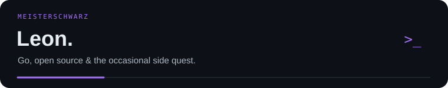
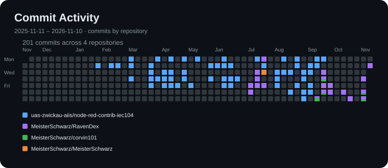
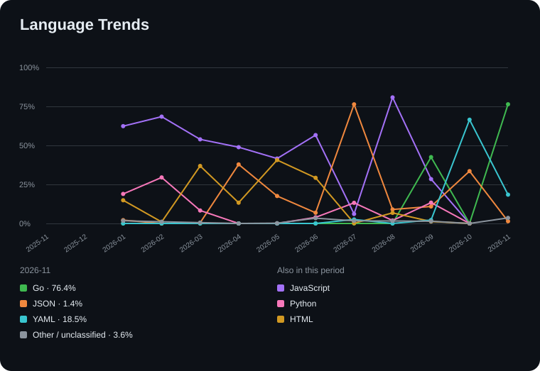
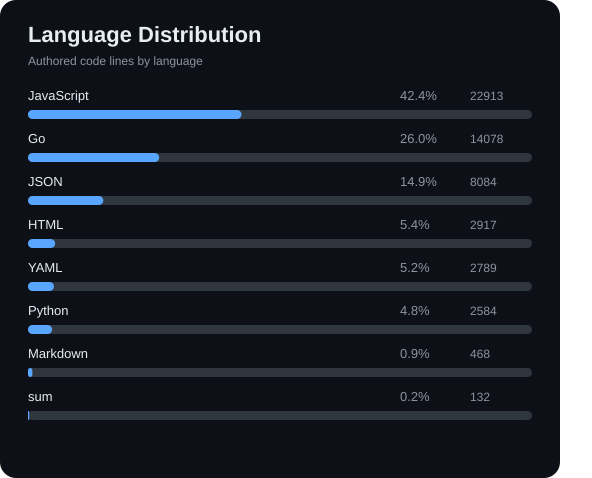
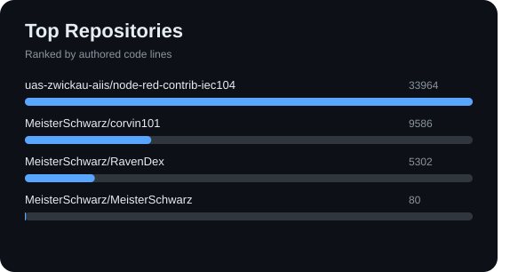
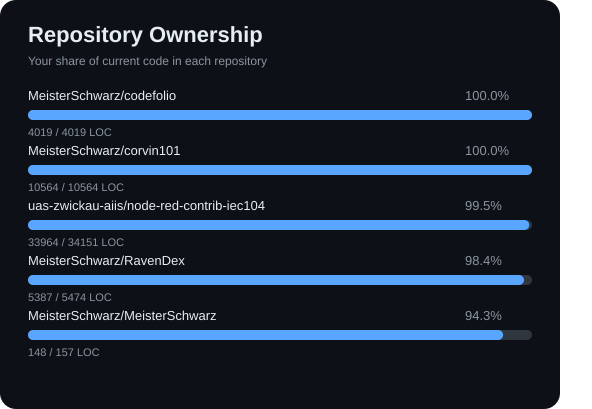
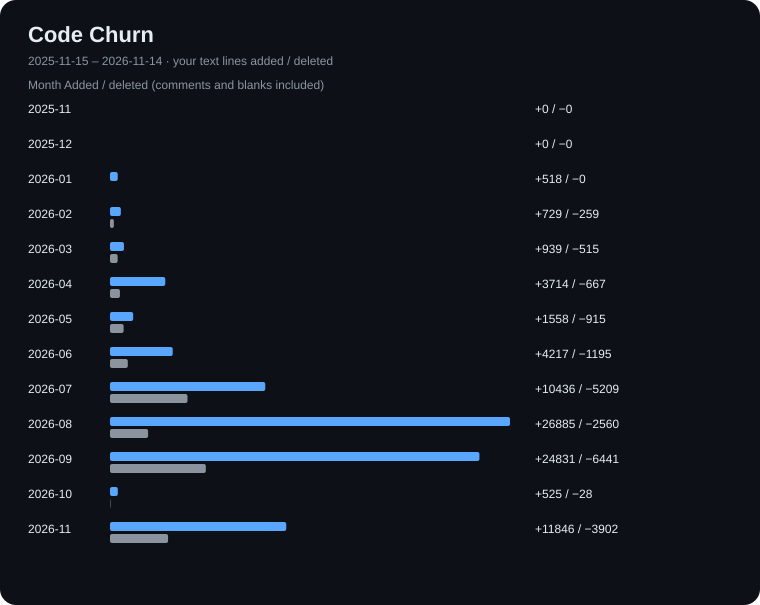

  

### Practical problems. Personal curiosity.

I like building tools that make something a little simpler.
Sometimes that means connecting systems at work. Sometimes it's a personal rabbit hole.
I enjoy figuring out the details and sharing the result through **open source**.

### A little work. A little tinkering.

<em>Some ideas belong to the workday. Others follow me home.</em>

  

### The problem gets the final say.

Go is where I tend to begin. The rest depends on what I'm building.
Language shares of the lines I add each month.

  

 

<strong>Take a closer look</strong> · the code behind the charts

 

#### The code that stays

A few different views of the work I've contributed over time.

<strong>Language mix</strong>

The languages in my authored code that is still present in these repositories.

 
 

<strong>Where my code lives</strong>

The projects containing the most of my surviving authored code, across work and personal tinkering.

 
 

<strong>Part of a bigger picture</strong>

My authored lines as a share of each project's current codebase, including the ones I contribute to alongside others.

 
 

#### Room for revision

<em>Not every useful change adds a line.</em> Monthly text lines added and removed.

  

 

  <samp>curiosity → code → repeat</samp> 
  Charts made with <a href="https://github.com/MeisterSchwarz/codefolio">Codefolio</a>.

